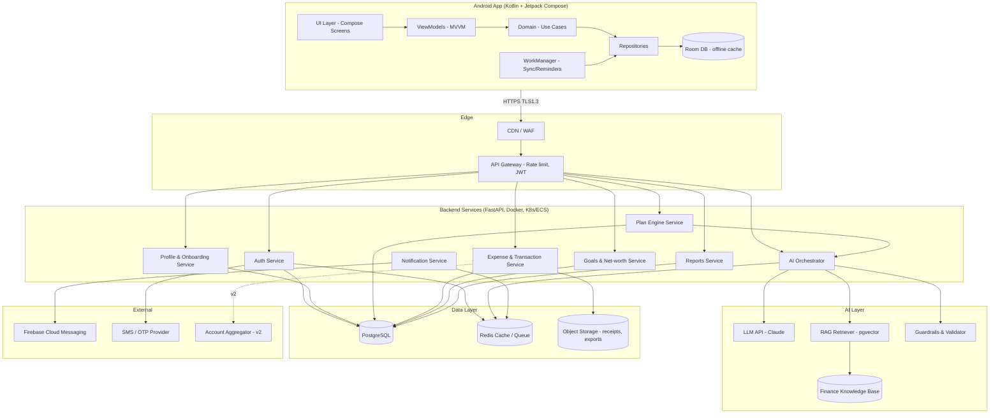
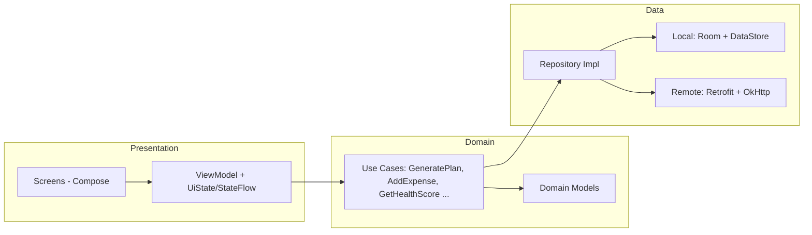
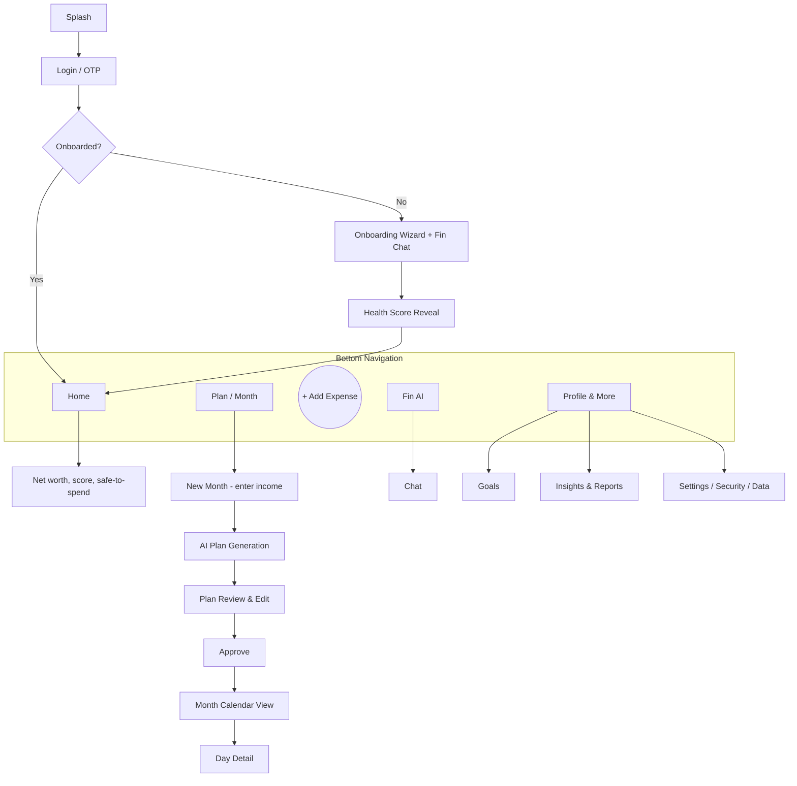

# PersonalFin — Design Document (Architecture + Frontend)

## Part A — System Architecture

### A1. High-Level Architecture



### A2. Android Architecture (Clean Architecture + MVVM)



**Key decisions**
- **Local-first:** Room is the UI's source of truth; background sync pushes/pulls deltas (offline expense logging).
- **DI:** Hilt. **Async:** Coroutines + Flow. **Navigation:** Navigation-Compose. **Images/Charts:** Coil, Vico/MPAndroidChart.
- **Security:** EncryptedSharedPreferences/Keystore, SQLCipher for Room, biometric prompt, cert pinning, `FLAG_SECURE` on sensitive screens.
- **Modules (Gradle):** `app`, `core:ui`, `core:network`, `core:database`, `feature:auth`, `feature:onboarding`, `feature:planner`, `feature:expenses`, `feature:calendar`, `feature:goals`, `feature:advisor`, `feature:insights`.

### A3. Architectural Principles
1. LLM never calculates money — **Plan Engine** (deterministic) does; LLM explains.
2. Everything auditable — plans store inputs, rules version, model version.
3. Privacy by design — PII minimised/redacted before any LLM call.
4. Stateless backend services; state in Postgres/Redis.
5. Graceful degradation — if AI is down, rule-based plan still works.

---

## Part B — Frontend / UI Design

### B1. Design Language: "Aurora Violet"
Calm, premium, intelligent. Soft gradients, glassmorphism cards, glowing AI accents, generous whitespace.

#### Colour Palette

| Token | Hex | Usage |
|---|---|---|
| `Violet900` | `#2E1065` | Headers on dark, deep text accents |
| `Violet700` | `#5B21B6` | Primary buttons (pressed), nav active |
| `Violet600` | `#7C3AED` | **Primary** |
| `Violet500` | `#8B5CF6` | Primary light, charts |
| `Violet400` | `#A78BFA` | Secondary accents, icons |
| `Violet300` | `#C4B5FD` | Outlines, chips |
| `Violet200` | `#DDD6FE` | Tonal fills |
| `Violet100` | `#EDE9FE` | Card tints |
| `Violet50`  | `#F5F3FF` | App background (light) |
| `White`     | `#FFFFFF` | Surfaces, cards |
| `Lavender glow` | `#E9D5FF` → `#C084FC` | AI glow / gradient end |
| `Ink`       | `#1E1B2E` | Primary text |
| `Slate`     | `#6B6685` | Secondary text |
| `Success`   | `#10B981` | On-track (kept soft) |
| `Warning`   | `#F59E0B` | Near limit |
| `Danger`    | `#EF4444` | Over budget |

**Signature gradient (AI):** `linear(135°, #7C3AED → #A855F7 → #C084FC)`
**Dark mode:** background `#0F0A1F`, surface `#1A1333`, card `#241B45`, text `#F3EEFF`.

#### Typography
- Headings: **Plus Jakarta Sans** / **Sora** (SemiBold, tight tracking)
- Body: **Inter**
- Numbers (₹ amounts): **Inter Tabular / JetBrains Mono** for alignment

| Style | Size/Weight |
|---|---|
| Display (balance) | 36 / Bold |
| H1 | 28 / SemiBold |
| H2 | 22 / SemiBold |
| Body | 16 / Regular |
| Caption | 12 / Medium |

#### Shape, Elevation & Motion
- Corner radius: 20dp cards, 14dp inputs, full pill for chips/buttons.
- Elevation: soft violet-tinted shadows (`#7C3AED` @ 12% alpha).
- Glass cards: white @ 70% + blur 20 + 1dp `#DDD6FE` border.
- AI motion: pulsing orb / shimmering gradient while "thinking"; number count-up; progress rings animate; spring-based transitions (300 ms).

#### Material 3 Theme Mapping (Compose)
```kotlin
val LightColors = lightColorScheme(
    primary = Color(0xFF7C3AED),
    onPrimary = Color.White,
    primaryContainer = Color(0xFFEDE9FE),
    onPrimaryContainer = Color(0xFF2E1065),
    secondary = Color(0xFFA78BFA),
    background = Color(0xFFF5F3FF),
    surface = Color.White,
    onSurface = Color(0xFF1E1B2E),
    outline = Color(0xFFC4B5FD)
)
```

### B2. "Looks AI-created" Visual Cues
- **Fin Orb:** animated gradient sphere as the AI avatar (idle breathing, thinking swirl).
- **Sparkle ✦ icon** marks every AI-generated insight.
- Streaming typewriter text in chat; shimmering skeleton loaders.
- Gradient hero card with glowing border for the monthly plan.
- Suggestion chips ("Why this split?", "What if I save more?").
- Subtle mesh-gradient backgrounds on onboarding and splash.

### B3. Navigation Map



### B4. Screen Specifications

| # | Screen | Key Components |
|---|---|---|
| 1 | **Splash** | Violet mesh gradient, logo, Fin orb animation |
| 2 | **Login / OTP** | Phone input, OTP boxes, Google button, consent checkbox |
| 3 | **Onboarding Wizard** | Step progress bar, sections (Personal → Income → Expenses → Assets → Liabilities → Insurance → Goals → Risk), save & resume, Fin helper bubbles |
| 4 | **Health Score Reveal** | Animated score ring (0–100), strengths/gaps cards, "Your first plan" CTA |
| 5 | **Home Dashboard** | Greeting, net-worth card (gradient), Safe-to-spend today, plan-vs-spent ring, upcoming dues, AI insight card, recent transactions |
| 6 | **New Month** | Month picker, income input (big numeric), extra income, one-off expenses via mini calendar, template selector, "Generate with Fin ✦" |
| 7 | **AI Plan Review** | Donut chart of buckets, list of allocations with ₹/%/why, sliders to tweak, constraint warnings, Approve button |
| 8 | **Month Calendar** | Month grid with spend heatmap (violet intensity), event dots (EMI/SIP/bills), summary bar (Planned/Spent/Left) |
| 9 | **Day Detail** | Bottom sheet: day's transactions, add button, notes |
| 10 | **Add Expense** | Calculator keypad, category chips, payment mode, date, recurring toggle, voice/scan icons |
| 11 | **Expenses List** | Search, filters, grouped by day, swipe edit/delete |
| 12 | **Budget Tracker** | Category progress rings/bars: Green→Amber→Red |
| 13 | **Fin AI Chat** | Message bubbles, streaming text, quick chips, source/assumption expandable |
| 14 | **Goals** | Cards with progress rings, ETA, required SIP, add goal flow |
| 15 | **Insights** | Trends charts, category breakdown, net-worth line, month report card |
| 16 | **What-If Simulator** | Sliders (income, SIP, EMI) with live projected chart |
| 17 | **Profile & Settings** | Financial profile edit, risk retake, notifications, biometric lock, language, theme, export/delete data, disclaimer |

### B5. Key Screen Wireframes (ASCII)

**Home**
```
┌──────────────────────────────┐
│ Hi Roni ✦          🔔  (👤)  │
│ ┌──────────────────────────┐ │
│ │  NET WORTH               │ │  ← gradient violet card
│ │  ₹ 4,82,300   ▲ 3.2%     │ │
│ │  Health Score  72 ◔      │ │
│ └──────────────────────────┘ │
│  Safe to spend today ₹ 820   │
│ ┌────────────┐ ┌───────────┐ │
│ │ Plan vs    │ │ Upcoming  │ │
│ │ Spent  ◕   │ │ EMI 5th   │ │
│ │ 62% used   │ │ SIP 10th  │ │
│ └────────────┘ └───────────┘ │
│ ✦ Fin Insight: Dining out is │
│   18% over plan. Adjust?     │
│ Recent ▸ Swiggy  −₹420       │
├──────────────────────────────┤
│ 🏠   📅   ( + )   ✦   ☰      │
└──────────────────────────────┘
```

**Plan Review**
```
┌──────────────────────────────┐
│ ← October 2026 Plan          │
│ Income ₹60,000               │
│        ◔ donut chart         │
│ ▸ Essentials      ₹22,000 37%│
│    ✦ Why? covers rent, food… │
│ ▸ Home-loan EMI   ₹14,000 23%│
│ ▸ Emergency Fund  ₹ 6,000 10%│
│ ▸ Investments     ₹ 5,000  8%│
│     ─────●────── (slider)    │
│ ⚠ Reducing below ₹4,000 delays│
│   emergency fund by 2 months │
│ [ Re-generate ✦ ] [ Approve ]│
└──────────────────────────────┘
```

**Calendar**
```
┌──────────────────────────────┐
│ ‹  October 2026  ›           │
│ S  M  T  W  T  F  S          │
│    1  2  3  4  5• 6          │
│ 7  8  9 10• 11 12 13         │  ← shade = spend intensity
│ ...                          │  ← • = EMI / SIP / bill
│ Planned 60k │ Spent 24k │ Left│
└──────────────────────────────┘
```

### B6. Component Library
Primary/secondary/tonal buttons · Gradient hero card · Glass card · Stat tile · Progress ring · Segmented bucket bar · Category chip · Fin message bubble · Fin orb · Calendar day cell (heat levels 0–4) · Numeric keypad · Bottom sheet · Insight banner · Skeleton loader · Toast/Snackbar.

**Heatmap levels:** `#F5F3FF` → `#DDD6FE` → `#A78BFA` → `#7C3AED` → `#4C1D95`.

### B7. Accessibility & Localisation
Contrast ≥ 4.5:1 (white on `#7C3AED` = 5.7:1 ✔), 48dp touch targets, TalkBack labels, never colour-only status (icons + text), font scaling to 200%, RTL-safe layouts, string resources for EN/TA/HI, INR formatting (`₹ 1,23,456`).

### B8. UX Principles
1. One primary action per screen. 2. Explain every AI number. 3. Never shame overspending — nudge kindly. 4. Progressive disclosure for complexity. 5. Celebrate small wins (confetti on goals hit).
