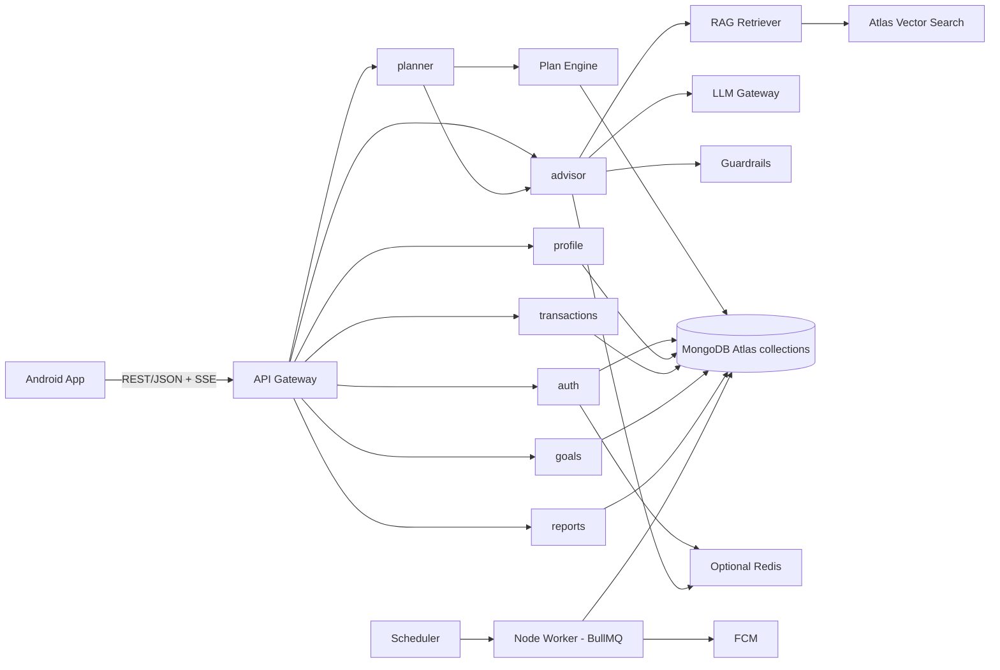
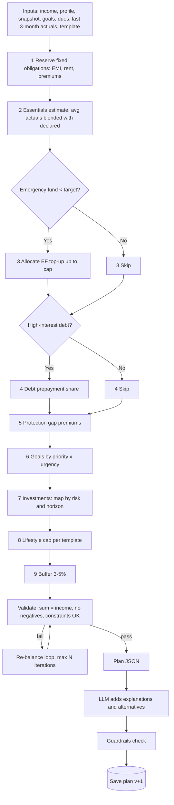
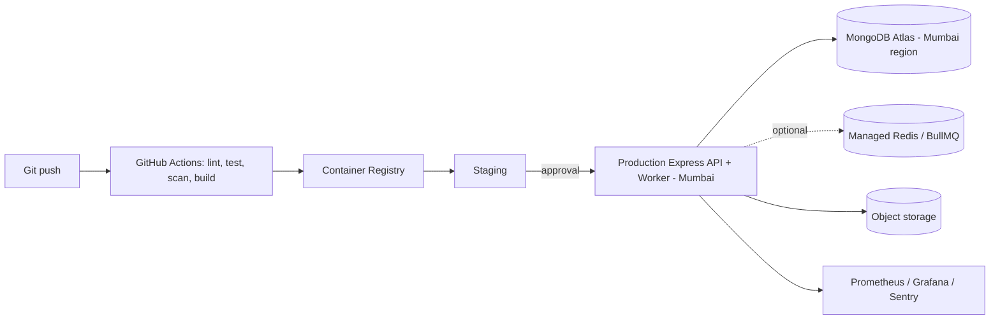

# PersonalFin — Backend Architecture

## 1. Style & Stack
Start with a modular monolith: one Express API and one worker process, with modules split by domain. Extract services only when traffic or team ownership justifies the operational cost.

| Concern | Technology |
|---|---|
| API | Node.js LTS, TypeScript, Express 5, Zod request validation |
| DB | MongoDB Atlas, MongoDB Node.js driver via Mongoose |
| Cache/Queue | Optional Redis + BullMQ for scheduled and retryable jobs |
| AI | Claude API, MongoDB Atlas Vector Search for RAG, deterministic TypeScript Plan Engine |
| Auth | OTP + Google OAuth → JWT (access 15 min / refresh 30 d, rotating) |
| Storage | S3-compatible (receipts, PDF exports) |
| Notifications | FCM |
| Infra | Docker, managed Node hosting (e.g. ECS/Cloud Run), Terraform, GitHub Actions |
| Observability | OpenTelemetry, Prometheus, Grafana, Sentry |

## 2. Component View



## 3. Modules & Responsibilities

| Module | Responsibility |
|---|---|
| **auth** | OTP issue/verify, Google login, JWT, device registry, session revocation |
| **profile** | Onboarding data, snapshots, health score, risk profile; documents keyed by `userId` |
| **planner** | Month creation, income entry, plan generation, versions, approval |
| **plan-engine** | Deterministic allocation: constraints, templates, goal prioritisation, asset-class mapping |
| **transactions** | Expense CRUD, categories, recurring rules, sync, budget-vs-actual |
| **goals** | Goals, SIP maths, projections, net worth |
| **advisor** | Chat orchestration, context building, Atlas Vector Search, LLM calls, guardrails |
| **reports** | Monthly report card, aggregation pipelines, PDF/CSV export |
| **notifications** | Rules + scheduled reminders, FCM dispatch |
| **compliance** | Consent log, audit log, data export/erase |

Organize each Express module into routes, controllers, domain services, and repositories. Middleware handles JWT authentication, Zod request validation, rate limits, request IDs, and consistent RFC 7807 errors. Mongoose validates persisted document shapes; keep plan calculations in a pure TypeScript domain module. Repositories must scope user-owned reads and writes by the authenticated `userId`.

## 4. Plan Engine (Core Algorithm)



**Plan JSON contract (excerpt)**
```json
{
  "month": "2026-10",
  "income_total": 60000,
  "template": "family_balanced",
  "rules_version": "2026.09.1",
  "allocations": [
    {"bucket": "essentials", "amount": 22000, "pct": 36.67,
     "reason": "Avg last 3 months ₹21.4k + 3% festive buffer"},
    {"bucket": "emergency_fund", "amount": 6000, "pct": 10.0,
     "reason": "You have 2.5 of 6 months covered"},
    {"bucket": "investment", "amount": 5000, "pct": 8.33,
     "breakdown": {"index_fund": 3000, "debt_fund": 1500, "gold": 500}}
  ],
  "warnings": [],
  "assumptions": ["Moderate risk", "Inflation 6%"]
}
```

**AI safety design**
- LLM receives a *structured, redacted* context (no name/phone/account no.).
- LLM output is JSON-schema constrained for explanations; amounts come only from engine.
- Guardrail checks block: guaranteed returns, specific stock/security tips, tax-evasion advice, medical/legal claims.
- Prompt templates, model version, and retrieved KB doc IDs logged for audit.

## 5. API Design (REST, `/api/v1`)

| Group | Method & Path | Description |
|---|---|---|
| Auth | `POST /auth/otp/request` · `POST /auth/otp/verify` · `POST /auth/google` · `POST /auth/refresh` · `POST /auth/logout` | Login flows |
| Profile | `GET/PUT /profile` · `POST /onboarding/sections/{name}` · `GET /onboarding/status` | Onboarding |
| Snapshot | `POST /snapshots` · `GET /snapshots/latest` · `GET /health-score` | Financial status |
| Assets/Debts | `CRUD /assets` · `CRUD /liabilities` · `CRUD /insurance` | Portfolio |
| Months | `POST /months` · `GET /months/{yyyy-mm}` · `PUT /months/{yyyy-mm}/income` | Month page |
| Plans | `POST /months/{yyyy-mm}/plans:generate` · `GET /months/{yyyy-mm}/plans` · `PATCH /plans/{id}/allocations` · `POST /plans/{id}:approve` | Planning |
| Calendar | `GET /months/{yyyy-mm}/calendar` | Heatmap + events |
| Transactions | `CRUD /transactions` · `POST /transactions:sync` · `GET /months/{yyyy-mm}/budget-status` | Tracking |
| Recurring | `CRUD /recurring` | Auto entries |
| Goals | `CRUD /goals` · `GET /goals/{id}/projection` | Goals |
| Advisor | `POST /advisor/chat` (SSE stream) · `GET /advisor/conversations` | Fin AI |
| What-if | `POST /simulations` | Scenario |
| Reports | `GET /reports/monthly/{yyyy-mm}` · `GET /reports/export?format=pdf\|csv` | Reports |
| Notifications | `GET /notifications` · `PUT /notifications/settings` | Alerts |
| Privacy | `POST /privacy/export` · `DELETE /privacy/account` | DPDP rights |

**Conventions:** JSON, ISO-8601 dates, amounts as integer **paise** (or BSON `Decimal128` where fractional paise is required), idempotency keys for sync/POST, cursor pagination using stable `(createdAt, _id)` ordering, RFC 7807 errors, rate limits (e.g. 60 req/min/user; chat 20/min).

## 6. Sync Strategy (Offline-first)
Client generates UUID `clientId` values → queues mutations locally → pushes batches to `/transactions:sync` with `updatedAt` and `clientId`. A unique MongoDB index on `(userId, clientId)` makes retries idempotent. The server applies the documented last-write-wins policy per field and records deletes as tombstones; clients pull changes with an opaque cursor. Never accept `userId` from a sync payload as authority; derive it from the verified access token.

## 7. Background Jobs

| Job | Schedule | Action |
|---|---|---|
| Recurring txn generator | Daily 00:05 IST | BullMQ scheduled job creates due entries idempotently |
| Due reminders | Daily 08:00 | Push EMI/SIP/bill reminders |
| Budget breach checker | On transaction write | Recompute affected category and enqueue 80% / 100% alerts |
| Month-start prompt | 1st of month | "Enter income & get plan" |
| Month-end report | Last day 20:00 | Build report card |
| Net-worth snapshot | Monthly | Store snapshot document |
| KB re-index | On KB update | Update Atlas Vector Search embeddings |

For an MVP, scheduled jobs may run from a single worker with a MongoDB-backed lease/lock. Add Redis + BullMQ when retries, throughput, and independent worker scaling justify another service.

## 8. Security
- TLS 1.3, HSTS, cert pinning in app; WAF; per-IP & per-user rate limits.
- Passwords not used; OTP w/ attempt limits & cooldown; refresh-token rotation + reuse detection.
- Field-level encryption (AES-GCM, KMS-managed keys) for PII/financial identifiers. MongoDB does not provide built-in row-level tenant security: every repository query must include `userId` derived from the verified JWT, with cross-user isolation tests.
- Secrets in Secrets Manager; least-privilege IAM; dependency & container scanning.
- Append-only **audit_logs** collection; consent records; PII redaction pipeline before LLM calls.
- Backups (PITR), encrypted; data residency in India (Mumbai region).
- OWASP ASVS / MASVS checklist; periodic pen-test.

## 9. Deployment



Environments: `dev`, `staging`, `prod`. Deploy the API and worker as versioned containers. Evolve MongoDB documents with versioned, idempotent migration scripts and backward-compatible readers; use Atlas backups and a tested restore procedure for production.

## 10. Testing Strategy
Unit (engine rules — property-based tests: sum==income, no negatives) · API contract tests · golden-file tests for plans across personas · LLM eval set (accuracy, guardrails, tone) · load tests (k6) · Android UI tests (Compose) · security tests.

## 11. Scalability & Cost Notes
Use compound indexes and bounded aggregation pipelines for dashboard/report queries; add caching only for measured hot paths. Stream LLM responses (SSE); use smaller models for chat classification/routing and larger models for plan explanations; cap tokens per user/day. Use Atlas Vector Search for embeddings. Shard only after measured growth requires it; denormalize read-heavy data rather than assuming relational joins.
