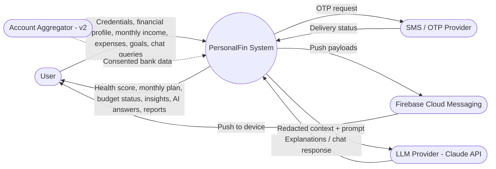
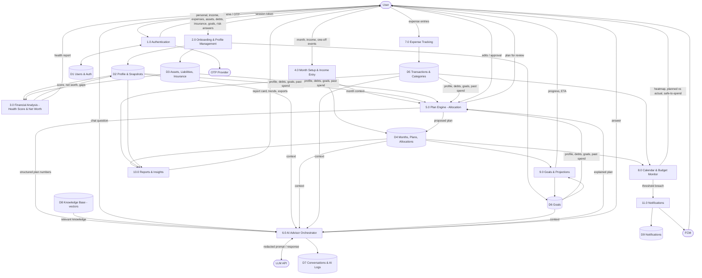
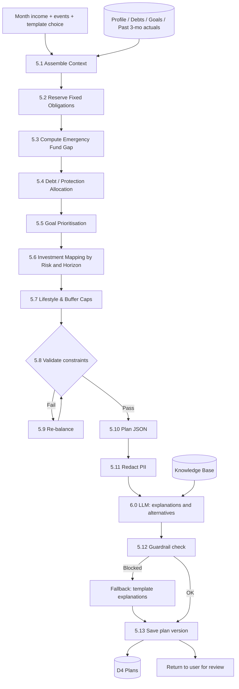
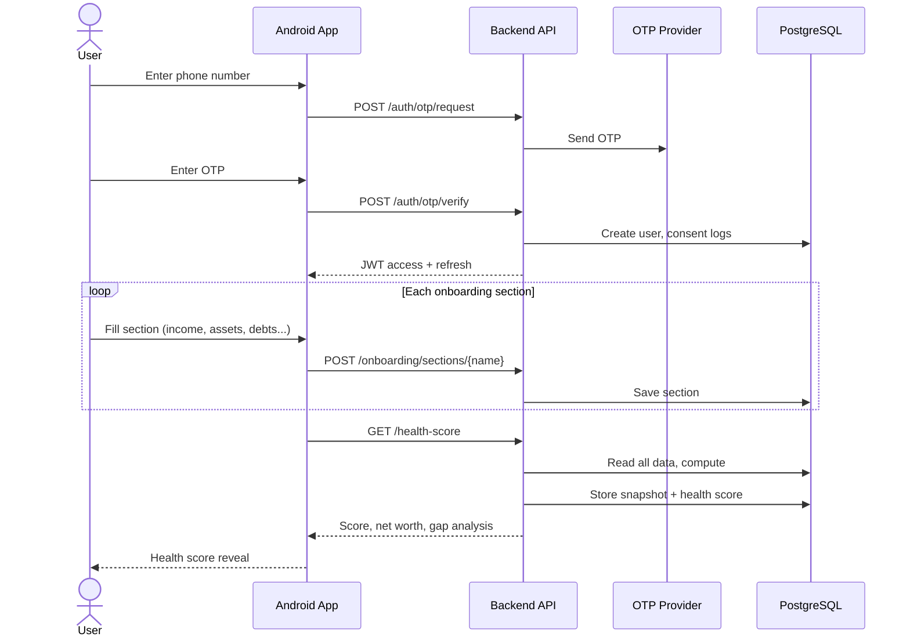
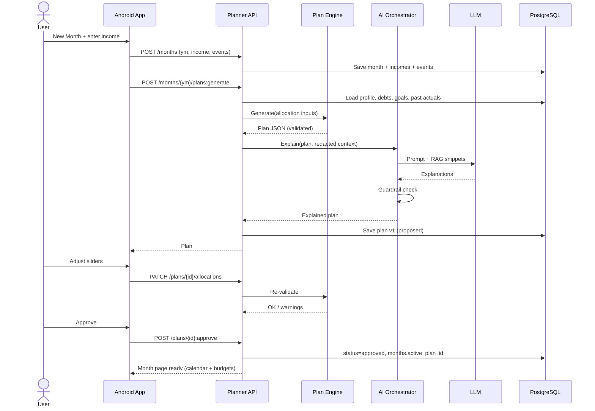
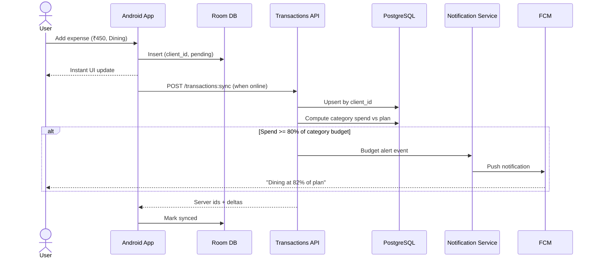
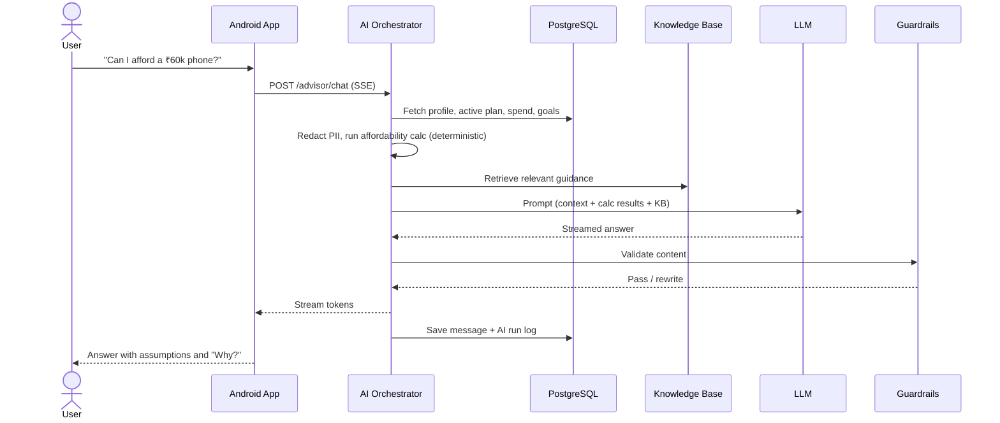

# PersonalFin — Data Flow Diagrams

## 1. DFD Level 0 — Context Diagram

## 2. DFD Level 1 — Whole Application

## 3. DFD Level 2 — Monthly Plan Generation (Process 5.0)

## 4. Sequence — First Login & Onboarding

## 5. Sequence — Monthly Plan Creation

## 6. Sequence — Expense Logging & Alerts (offline-first)

## 7. Sequence — AI Chat

## 8. Data Dictionary (Flows)

| Flow | Data items |
|---|---|
| Profile data | age, city tier, dependents, occupation, risk answers, tax regime |
| Financial status | incomes, fixed/variable expenses, assets by class, loans (outstanding, rate, EMI), insurance cover |
| Month input | ym, income entries, one-off events, template |
| Plan | buckets, amounts, %, reasons, assumptions, warnings, rules_version |
| Expense | amount, category, date, payment mode, merchant, note, source |
| Budget status | planned, spent, remaining, safe-to-spend/day |
| AI request | redacted context, calc results, retrieved KB chunks, prompt version |
| Notification | type, title, body, schedule |
